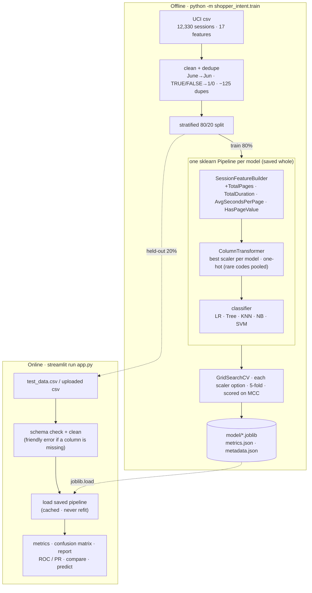

# Shopper Intent Lab — ML Assignment 2

**Name / Roll No.:** 2026AJ05820  ·  M.Tech (AIML) · Machine Learning · Assignment 2

| | |
|---|---|
| **GitHub repository** | `<add your GitHub repo link here>` |
| **Live Streamlit app** | `<add your Streamlit Community Cloud link here>` |

---

## a. Problem statement

An online store gets thousands of browsing sessions a day, but only about **one in six ends in a purchase**.
Using what a visitor did during a session (pages opened, time spent, how "valuable" those pages are according to
Google Analytics, and when they visited), the goal is to **predict whether the session will end in a purchase**
(`Revenue = True`).

This is a **binary classification** problem with an **imbalanced** target (84.5% / 15.5%). Five classifiers are
trained on the same data and compared on Accuracy, AUC, Precision, Recall, F1 and MCC. They are then served through
an interactive Streamlit app that evaluates the saved models on an uploaded test csv, without retraining.

## b. Dataset description

| | |
|---|---|
| **Name** | Online Shoppers Purchasing Intention Dataset |
| **Source** | UCI Machine Learning Repository — <https://archive.ics.uci.edu/dataset/468/online+shoppers+purchasing+intention+dataset> |
| **Instances** | 12,330 sessions (12,205 after removing 125 exact duplicates) |
| **Features** | 17 (10 numeric, 7 categorical) + 1 binary target |
| **Target** | `Revenue` — did the session end in a purchase? (`True` 15.5%, `False` 84.5%) |
| **Missing values** | none |
| **Split** | stratified 80 / 20 → 9,764 train (`data/train_data.csv`) / 2,441 test (`test_data.csv`) |

| Column | Type | Meaning |
|---|---|---|
| `Administrative`, `Informational`, `ProductRelated` | int | number of pages of each type visited in the session |
| `Administrative_Duration`, `Informational_Duration`, `ProductRelated_Duration` | float | seconds spent on each page type |
| `BounceRates` | float | avg. % of visitors who entered on these pages and left without another request |
| `ExitRates` | float | avg. % of page views that were the last in their session |
| `PageValues` | float | avg. value of the pages visited before a transaction |
| `SpecialDay` | float | closeness of the visit to a special day such as Valentine's or Mother's Day (0–1) |
| `Month` | category | month of the visit (10 months present; no Jan / Apr) |
| `OperatingSystems`, `Browser`, `Region`, `TrafficType` | category (int code) | technical / traffic-source codes |
| `VisitorType` | category | `Returning_Visitor`, `New_Visitor`, `Other` |
| `Weekend` | bool | visit on a weekend |
| **`Revenue`** | **bool (target)** | **session ended in a purchase** |

**Key EDA findings** (full analysis in [`notebooks/2026AJ05820_ML_Assignment2.ipynb`](notebooks/2026AJ05820_ML_Assignment2.ipynb)):

* `PageValues` is the strongest signal. Sessions that never reach a page with value convert ~4% of the time;
  those that do convert ~56%.
* Page counts, durations and `PageValues` are heavily right-skewed (skew 4–8). `log1p` brings most of them close
  to symmetric, so they are log-transformed before scaling.
* November (~25%) and Oct/Sep convert far above average; February barely converts (~2%). New visitors convert more
  often than returning ones (24% vs 14%).
* `BounceRates` ↔ `ExitRates` correlate at 0.90, and `ProductRelated` ↔ its duration at 0.85.
* `OperatingSystems` / `Browser` / `Region` / `TrafficType` are labels, not quantities, so they are one-hot encoded,
  with rare codes (< 30 sessions) pooled.

## c. GitHub repository

Repository link: `<add your GitHub repo link here>`

```
2026AJ05820_ML_Assignment2/
├── app.py                       # Streamlit entry point (sidebar + 7 tabs)
├── requirements.txt             # pinned versions (scikit-learn must match the .joblib files)
├── README.md
├── test_data.csv                # held-out 20% test split incl. Revenue -> upload this in the app
├── model/                       # saved, fitted pipelines (preprocessing + classifier)
│   ├── logistic_regression.joblib
│   ├── decision_tree.joblib
│   ├── knn.joblib
│   ├── naive_bayes.joblib
│   ├── svm.joblib
│   ├── metrics.json             # test-set metrics (the table below)
│   └── metadata.json            # best hyper-parameters, CV scores, versions
├── shopper_intent/              # ML package, shared by notebook, trainer and app
│   ├── config.py                #   paths, column groups, seed
│   ├── data.py                  #   load / clean / dedupe / split / schema validation
│   ├── features.py              #   SessionFeatureBuilder + ColumnTransformer
│   ├── models.py                #   registry of the 5 models + tuning grids
│   ├── evaluation.py            #   the 6 metrics, confusion matrix, ROC / PR
│   ├── trace.py                 #   runs a csv through a saved model stage by stage
│   ├── artifacts.py             #   save / load model/ files
│   └── train.py                 #   `python -m shopper_intent.train`
├── ui/                          # Streamlit front-end
│   ├── theme.py · charts.py · components.py · state.py
│   └── views/                   #   guide · evaluate · compare · pipeline · predict · train_lab · about
├── notebooks/
│   └── 2026AJ05820_ML_Assignment2.ipynb   # EDA + training walkthrough (executed)
├── data/
│   ├── online_shoppers_intention.csv      # original UCI file
│   └── train_data.csv                     # 80% training split
├── tests/test_pipeline.py       # cleaning, schema checks, saved models reproduce metrics.json
└── .streamlit/config.toml       # app theme
```

### How it fits together



**Design choices**

* **One pipeline per model.** Feature engineering, scaling and encoding are inside each saved `.joblib`, so the app
  passes raw csv rows straight in. No separate scaler file can fall out of sync, and there is no train/serve skew.
* **One registry** (`shopper_intent/models.py`). The trainer, notebook, app dropdown and Training Lab all read the
  same list of models, so adding a model is a single entry.
* **MCC for tuning and ranking.** With 84.5% negatives, always predicting "no purchase" scores 84.5% accuracy but MCC 0.
* **Leakage-safe.** Duplicates are removed before splitting, all EDA and tuning use the training split only, and
  the test split is touched once, for the final numbers.
* **Reproducible.** Fixed seed (42) and pinned versions. `tests/` checks that the saved models reproduce
  `model/metrics.json` exactly.

## d. Models used

Five classifiers, all trained on the same features and split. Hyper-parameters were tuned with 5-fold stratified
`GridSearchCV` on the training split (scored on MCC), and each model also chose its own preprocessing the same way. Metrics are on the **held-out test set (2,441 sessions)**.
Precision, Recall and F1 are for the positive class (*Purchase*).

### Comparison table

| ML Model Name | Accuracy | AUC | Precision | Recall | F1 | MCC |
|---|---|---|---|---|---|---|
| **Logistic Regression** | 0.8800 | **0.9240** | 0.5854 | 0.7984 | **0.6755** | **0.6150** |
| **Decision Tree** | 0.8947 | 0.9033 | 0.6959 | 0.5812 | 0.6334 | 0.5757 |
| **KNN** | 0.8943 | 0.9098 | 0.6962 | 0.5759 | 0.6304 | 0.5728 |
| **Naive Bayes** (Gaussian) | 0.8189 | 0.8903 | 0.4581 | **0.8586** | 0.5974 | 0.5348 |
| **Support Vector Machine** (RBF) | **0.9054** | 0.8877 | **0.7525** | 0.5890 | 0.6608 | 0.6129 |

Tuned hyper-parameters (from `model/metadata.json`):

| Model | Preprocessing | Best hyper-parameters | CV MCC |
|---|---|---|---|
| Logistic Regression | log1p + RobustScaler | `C=0.003, class_weight=balanced` | 0.6071 |
| Decision Tree | log1p + StandardScaler (scaling can't change a tree) | `criterion=entropy, max_depth=8, min_samples_leaf=20, class_weight=None` | 0.5865 |
| KNN | Yeo-Johnson | `n_neighbors=21, weights=distance, p=2` | 0.5891 |
| Naive Bayes | log1p + RobustScaler | `var_smoothing=0.1` | 0.5237 |
| SVM | Yeo-Johnson | `C=1.0, gamma=scale, class_weight=None` (+ `CalibratedClassifierCV` for probabilities) | 0.6139 |

### Preprocessing and scaling

Four options were compared per model with 5-fold CV on the training split only: log1p + StandardScaler, log1p + RobustScaler, log1p + MinMaxScaler (normalisation) and the Yeo-Johnson power transform. Before any of these, the pipeline also adds engineered features and one-hot encodes categories.

| Model | CV MCC: Standard | Robust | MinMax | Yeo-Johnson |
|---|---|---|---|---|
| Logistic Regression | 0.6021 | **0.6071** | 0.5932 | 0.5991 |
| KNN | 0.5673 | 0.5846 | 0.4658 | **0.5891** |
| Naive Bayes | 0.5230 | **0.5237** | 0.5059 | 0.5211 |
| SVM | 0.6055 | 0.5999 | 0.6111 | **0.6139** |

Scaling matters most for distance-based models, as KNN's range shows. The dataset's accuracy still tops out near 0.90, because many sessions look alike whether or not they end in a purchase. The test set was not used for any of these choices.

### Observations

| ML Model Name | Observation about model performance |
|---|---|
| **Logistic Regression** | Best MCC (0.615), F1 (0.676) and AUC (0.924). Strong regularisation (`C=0.003`) with `class_weight="balanced"` trades precision (0.59) for high recall (0.80): it catches 305 of 382 buyers, at the cost of 216 false alarms. Once skew is reduced, the signal is close to linear (dominated by `PageValues`), so a simple model does very well. |
| **Decision Tree** | Precise (0.70) but misses ~42% of buyers (recall 0.58). The root split is `PageValues` (66% of total importance). A fully grown tree overfits badly (CV MCC 0.478 vs 0.587 for the pruned depth-8 tree). Its leaf-average probabilities are coarse, which limits AUC to 0.903. Scaling has no effect on it. |
| **KNN** | With `k=21` and distance weighting it performs close to the tree (MCC 0.573): good precision, low recall. Buyers are a minority, so they are often outvoted by non-buyer neighbours. It is very sensitive to preprocessing (CV MCC 0.466 with MinMax vs 0.589 with Yeo-Johnson), and it has the largest model file because it stores the whole training set. |
| **Naive Bayes** | Lowest accuracy (0.819) and MCC (0.535). Its independence assumption is broken (Bounce↔Exit 0.90, page counts↔durations 0.85), and the one-hot columns are not Gaussian. It has the highest recall (0.86, catching 328 of 382 buyers) but also the most false alarms (388), giving precision of 0.46. |
| **Support Vector Machine** | Highest accuracy (0.905) and precision (0.75), with the fewest false alarms (74). MCC (0.613) is nearly tied with Logistic Regression. Without class weighting it is conservative, so recall is 0.59. It has the lowest AUC (0.888), and it is by far the slowest model to train and predict. |
| **Overall, winner for this dataset?** | **Logistic Regression**, narrowly. It leads on MCC, F1 and AUC and is the fastest and smallest of the strong models. The MCC gap to the **SVM** is only 0.002, effectively a tie, and the SVM is the better choice if accuracy or precision matters most, for example when each flagged visitor gets a costly discount. The threshold slider in the app shows this trade-off live. |

## Streamlit app

**Required features:**
* **CSV upload:** in the sidebar. Or use the bundled `test_data.csv`, which can also be downloaded from there.
* **Model dropdown:** in the sidebar.
* **Evaluation metrics:** six metric cards on the Evaluate tab.
* **Confusion matrix + classification report:** also on the Evaluate tab.

Uploaded data is only scored by the saved models; nothing is retrained on it.

| Tab | What it shows |
|---|---|
| 👋 **Start here** | What the project does, a four-step walkthrough, a map from each assignment requirement to its place in the app, and the saved results |
| 📊 **Evaluate** | 6 metric cards, interactive confusion matrix, classification report, ROC and precision-recall curves, a **decision-threshold slider** that recomputes every metric live, and a predictions download |
| 🏁 **Compare models** | All 5 saved models on the active file: leaderboard (best per metric highlighted), grouped metric bars, overlaid ROC / PR curves, automatic "best model" banner |
| ⚙️ **Pipeline** | Runs the active file through the saved model stage by stage (read, schema check, clean, engineer, scale and encode, predict, metrics) with live progress, row and column counts, timings, samples and a before/after scaling chart |
| 🧪 **Predict a session** | A form for one browsing session (presets: typical / real buyer / real non-buyer), scored by all 5 models at once |
| 🛠️ **Training lab** | Retrain any model with your own hyper-parameters on `data/train_data.csv`, choose a scaler, compare against the saved model, view the run history and download the new `.joblib`. Saved models in `model/` are never overwritten. |
| ℹ️ **About** | Problem statement, data dictionary, EDA charts, pipeline diagram, tuned hyper-parameters |

If an uploaded csv has no `Revenue` column, the app still returns predictions (and a download), and explains that
metrics need the target column. Files with missing feature columns get a clear error that lists the missing columns.

## Running locally

```bash
python -m venv .venv && source .venv/bin/activate
pip install -r requirements.txt

python -m shopper_intent.train          # retrain + tune all 5 models (~6 min); --quick for defaults
python -m pytest -q                     # 20 checks, incl. "saved models reproduce metrics.json"
streamlit run app.py                    # http://localhost:8501
```